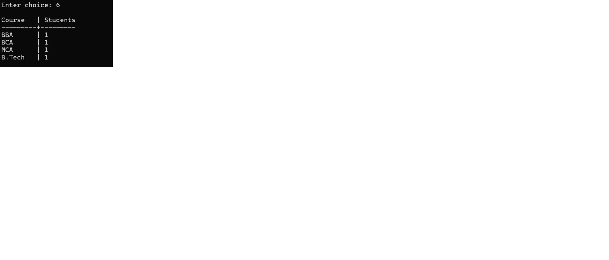
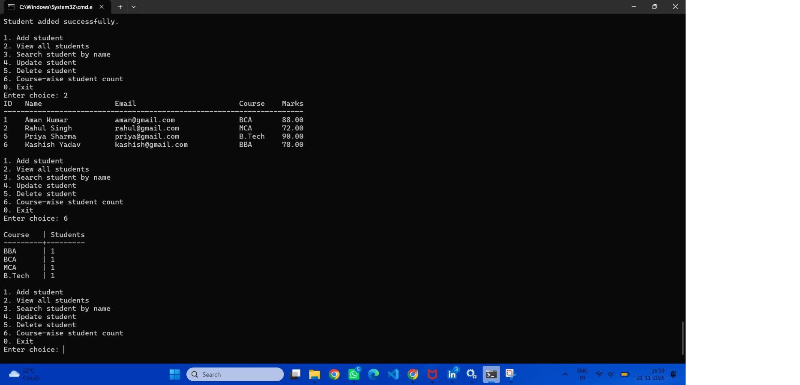

# Student Management System

A console-based Java application to manage student records using **Java, JDBC and MySQL**.

## Features

* Add, view, update, delete students (CRUD)
* Search students by name
* Course-wise student count report
* Input validation (name, email, marks) and exception handling
* Phone number validation (10-digit Indian mobile number)

## Tech Stack

Java 17, JDBC, MySQL, OOP

## Concepts Used

* **OOP:** encapsulation (private fields + getters/setters), inheritance (`Student extends Person`)
* **Collections:** `ArrayList` (list of students), `HashMap` (course id/name, course-wise count)
* **JDBC:** `Connection`, `PreparedStatement`, `ResultSet`
* **SQL:** SELECT, INSERT, UPDATE, DELETE, JOIN, GROUP BY
* **DAO pattern:** all SQL queries are kept in `StudentDAO`
* **Exception handling:** try-with-resources, `SQLException`, `NumberFormatException`

## Project Structure

```
student-management-system/
├── src/
│   ├── Main.java          (menu and user input)
│   ├── Person.java        (base class)
│   ├── Student.java       (extends Person)
│   ├── StudentDAO.java    (database operations)
│   ├── DBConnection.java  (JDBC connection)
│   ├── Validator.java     (input validation)
│   └── sms/sms/           (Spring Boot web app, Gradle)
├── sql/schema.sql         (database and tables)
└── lib/                   (put the MySQL connector jar here)
```

## How to Run (Console App)

1. Install JDK 17+ and MySQL.
2. Run `sql/schema.sql` in MySQL Workbench.
3. Download **mysql-connector-j** (jar file) from the MySQL website (Connector/J, "Platform Independent") and put the jar inside `lib/`.
4. Set your MySQL password as an environment variable.

   * Windows (CMD): `set DB_PASSWORD=your_password`
   * Linux/Mac: `export DB_PASSWORD=your_password`
   * Optional: `DB_USER` (default is `root`)
5. Compile and run from the project folder.

   * Windows:

     ```
     mkdir out
     javac -d out src\*.java
     java -cp "out;lib\*" Main
     ```

   * Linux/Mac:

     ```
     mkdir -p out
     javac -d out src/*.java
     java -cp "out:lib/*" Main
     ```

## Database Design

* `courses (course_id, course_name)`
* `students (id, name, email UNIQUE, course_id FOREIGN KEY, marks)`

## Web App

A separate Spring Boot web version is available in [`web/`](web/). See [`web/README.md`](web/README.md) for setup and run instructions.

## Spring Boot Web App (src/sms/sms)

This project also has a Spring Boot web app with a REST API and browser UI: student Add, Edit, Delete, Search and Course Count.

### Requirements

* JDK 25 (or change `languageVersion` in `src/sms/sms/build.gradle` to match your JDK)
* MySQL Server (8.x)

### Setup

1. Create the database (once): open `sql/schema.sql` in MySQL Workbench and run it, or use `mysql -u root -p < sql/schema.sql`. This creates the `student_db` database with the `courses` and `students` tables.
2. Go to the app folder, set the MySQL password and start the app (PowerShell):

   ```
   cd src\sms\sms
   $env:DB_PASSWORD="<mysql-password>"
   .\gradlew.bat bootRun
   ```

3. When `Started SmsApplication` appears, open http://localhost:8080 in the browser.

The password is not stored in code; it is read from the `DB_PASSWORD` environment variable. Press `Ctrl + C` in the same terminal to stop. If port 8080 is busy, set `$env:SERVER_PORT="8081"` before running.

### REST API

| Method | URL | Purpose |
|---|---|---|
| GET | `/api/students?search=text` | List students (search by name or email) |
| POST | `/api/students` | Add a student |
| PUT | `/api/students/{id}` | Update a student |
| DELETE | `/api/students/{id}` | Delete a student |
| GET | `/api/courses` | List courses |
| GET | `/api/reports/course-count` | Student count per course |

## Screenshots




